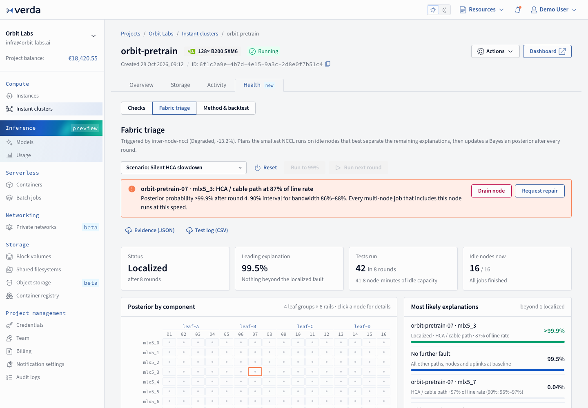

# Fabric triage for Verda Instant Clusters

**Live demo:** https://mohith26.github.io/verda-fabric-triage/ · unofficial concept by Mohith Gajjela, not affiliated with Verda.

When Verda's `inter-node-nccl` health check reports **Degraded**, it knows the 16-node AllReduce is slow but not *why*: one HCA or cable, one node's PCIe/NUMA path, or a leaf-to-spine uplink. Fabric triage answers that in a few minutes. It plans the smallest NCCL `all_reduce_perf` runs that fit on whatever nodes are idle right now, updates a Bayesian posterior over every candidate component after each round, and stops when one explanation holds at 99%. Then it lets you drain the node and attaches the evidence to a repair request. On 1,000 simulated incidents it named the exact HCA path, node or uplink **99.8%** of the time in a median of **5 rounds**, versus **79.2%** for threshold bisection.



## Why this matters for Verda

- Verda's [Instant clusters post (Sep 2026)](https://verda.com/blog/instant-clusters-h1-2026): "Some GPU and fabric degradations can be silent as your jobs just get slower." Health checks are judged against a committed baseline and reported as Healthy / Degraded / Failed.
- The [health-check docs](https://docs.verda.com/clusters/instant-clusters/kubernetes/health-checks/) list `inter-node-nccl` as a *fleet* check ("Full-cluster NCCL AllReduce over InfiniBand, compared with the baseline"). For a node-level issue the troubleshooting step is to "compare it with the other workers" by hand.
- Checks "only use idle nodes - they queue behind and never preempt your workloads" ([validation docs](https://docs.verda.com/clusters/instant-clusters/validation/)). A full-cluster rerun needs every node free at once; on a busy customer cluster that may not happen for hours. Fabric triage works in the gaps.
- The [HPC Engineer](https://jobs.verda.com/jobs/8229767-hpc-engineer) and [Cluster Orchestration](https://jobs.verda.com/jobs/8643127-senior-cluster-orchestration-engineer) roles call out InfiniBand performance validation, health checks and "perishable compute: gaps between jobs".

## How it works

1. **Hypotheses (177).** One degraded path per (node, HCA) = 128; node-wide faults (PCIe, NUMA, IOMMU) = 16; degraded leaf uplinks per (leaf group, rail) = 32; or "no persistent fault" (the Degraded run was transient). Severity is a free parameter on a 40-97% grid with extra prior mass at 50% (a link that trained at half rate or half width).
2. **Measurement model.** A ring/tree collective runs at the speed of its slowest participating path: `busbw = baseline(k, HCAs) × min(severity of affected faults) × noise`. Noise is Student-t (ν=5; 1.2% CV with all 8 HCAs, 1.8% for a single HCA) mixed with a 3% chance of unrelated transient congestion. Uplink faults only affect runs that cross leaf groups; single-node runs see no fabric at all (that is why `active-node-suite` stays Healthy).
3. **Planner.** Every round, a greedy packer fills idle *(node, HCA)* slots with the tests that maximise the entropy of the predicted outcome pattern over the posterior, minus a small node-minute cost. Rail-masked runs pin GPU r to HCA r (`CUDA_VISIBLE_DEVICES` + `NCCL_IB_HCA`), so up to 8 single-HCA tests can share a node in one round. Busy nodes are never touched. Joint entropy is submodular, so marginal gains fall within a round (tested).
4. **Stop rule and multiple faults.** When one component reaches 99% posterior it is confirmed and added to a known-fault set; tests that cross it are excluded and the posterior is recomputed for "anything else". The run ends when "nothing else is wrong" also reaches 99%. This localizes two simultaneous faults without enumerating pairs.
5. **Actions.** Drain the node (`scontrol update ... State=DRAIN` with the evidence in the reason), re-run `inter-node-nccl` on the remaining nodes, request a repair with every NCCL run attached, export evidence JSON / test log CSV. State persists in `localStorage`; every view has a deep link (`#/health/triage?preset=leaf-uplink`, `#/health/node/7`, `#/health/method`). Keyboard: `N` next round, `A` run to 99%.

All logic lives in [`src/triage.js`](src/triage.js) (no dependencies; the same module runs in the browser and in Node).

## Results

`node scripts/generate.mjs` (seeded, deterministic) writes `data/results.json`. 16 nodes × 8 HCAs, 4 leaf groups; each round ≈ 1 minute.

**Idle cluster, 1,000 incidents** (61% HCA paths, 17% node-wide, 22% leaf uplinks; 10% transient false alarms; 6% two faults at once; only incidents that trip the 0.95 registry threshold count):

| Method | Exact component | Right node / leaf | Rounds p50 | Rounds p90 | Node-minutes p50 | Silent faults (6-15% slower) |
|---|---|---|---|---|---|---|
| **Fabric triage** | **99.8%** | 100% | **5** | 8 | 40.3 | **100%** |
| Threshold bisection | 79.2% | 88.3% | 7 | 7 | 26.8 | 66.0% |
| All-pairs sweep (+ same Bayesian decoder) | 94.6% | 100% | 16 | 16 | 242 | 93.6% |

**Busy cluster** (half the nodes held by jobs, 500 incidents, counted within 60 rounds): fabric triage 99.4% exact (median 17 rounds), bisection 41.8%, all-pairs 29.0%, because fixed plans wait for their exact nodes.

**Calibration:** when fabric triage says 99%, it is right 99.8% of the time (idle). **Misspecification:** with 8% flaky runs while the model assumes 3%, it still gets 99.2%.

Baselines: *threshold bisection* follows topology-aware halving with a fixed pass/fail ratio (0.93), confirmation pairs, cross-leaf probing and HCA halving, as in NVIDIA Cluster Readiness Engine's `diagnose` mode and common runbooks. *All-pairs sweep* runs every node pair round-robin, then per-HCA tests on the worst node, decoded with the same posterior (so it isolates the value of adaptive design).

## Tests

```
node --test tests/*.test.mjs   # 14 tests, ~75 s (the headline test re-runs the 1,000-incident backtest)
```

Covers the hypothesis space and priors, the `affects` topology rules, baselines, likelihood peaking at the true fraction (randomized), planner never double-booking slots or using busy nodes (randomized), non-increasing greedy gains, every demo preset localized exactly under the UI's job schedule, severity interval coverage, masking after a node-wide finding, calibration of the stop rule (randomized backtest), evidence/CSV export, and exact reproduction of the headline numbers from `data/results.json`. CI: `.github/workflows/test.yml`.

## Limitations (honest)

- **Simulated fabric.** Topology (4 leaf groups of 4 nodes per rail), noise levels and fault mix are assumptions seeded from public figures (8× 400 Gbit/s NDR per B200 node from Verda's ClusterMAX post; ~92% of line rate as the healthy busbw target from Together AI's cluster-testing guide). Nothing here was run on real hardware. Real numbers would come from Verda's committed baselines and `ibnetdiscover` topology.
- **Bottleneck model.** Real NCCL can route around some slow paths (adaptive routing, channel balancing), which would make severities look milder than they are. The likelihood would need fitting on real fault-injection data.
- **One fault at a time.** Two faults are found sequentially; three or more, or faults that only show under traffic patterns other than AllReduce, are out of scope.
- **Busy-cluster results depend on the job model** (jobs re-shuffle about every 3 rounds). If a faulty node sits inside a multi-day job, nothing can test it until the job ends; the planner shows which components are cleared and waits.
- **Cost.** Fabric triage uses ~50% more test node-minutes than bisection (40 vs 27) in exchange for ~20 points of accuracy and fewer rounds; the cost weight is a tunable knob.
- The console shell is rebuilt from Verda's production CSS tokens and icon sprite for fidelity; the Health tab, cluster and data are invented.

## Prior art and what is new

- **Group testing** for d defective items among N needs Ω(d log(N/d)) tests (Du and Hwang). NVIDIA's [Cluster Readiness Engine](https://docs.nvidia.com/cluster-readiness-engine/how-to-guides/adaptive-fault-isolation/) (2026) ships *adaptive fault isolation*: topology-aware hierarchical bisection with pass/fail thresholds, at node level. ByteDance's [ByteRobust](https://arxiv.org/abs/2509.16293) uses dual-phase horizontal/vertical grouping; [MegaScale](https://www.usenix.org/system/files/nsdi24-jiang-ziheng.pdf) runs neighbour all-reduce tests; Microsoft's [FaultSense](https://www.microsoft.com/en-us/research/publication/faultsense-fault-localization-in-large-scale-mixture-of-experts-model-serving-infrastructure) localizes gray failures in MoE serving with probes; [Together AI's guide](https://www.together.ai/blog/a-practitioners-guide-to-testing-and-running-large-gpu-clusters-for-training-generative-ai-models) describes testing pairs and groups to find bad nodes, leaves or spines.
- **What this adds:** (1) a calibrated Bayesian posterior instead of a pass/fail threshold, which is what catches *silent* 6-15% slowdowns (100% vs 66% for bisection here); (2) HCA-level and leaf-uplink localization, not just "which node"; (3) an information-optimal planner that packs rail-masked runs onto idle (node, HCA) slots of a *busy* cluster, matching Verda's never-preempt rule; (4) sequential handling of two faults; (5) placement as a product feature next to Verda's existing check registry, with drain and repair actions. I did not find this combination in Verda's docs, changelog or blog (checked Nov 2026).

## Run locally

```
python3 -m http.server      # then open http://localhost:8000
node scripts/generate.mjs   # regenerate data/cluster.json and data/results.json (~3 min)
```

Static HTML/CSS/JS, no build step. Fonts: Source Sans 3 / Source Code Pro (Google Fonts), as in the Verda console.
